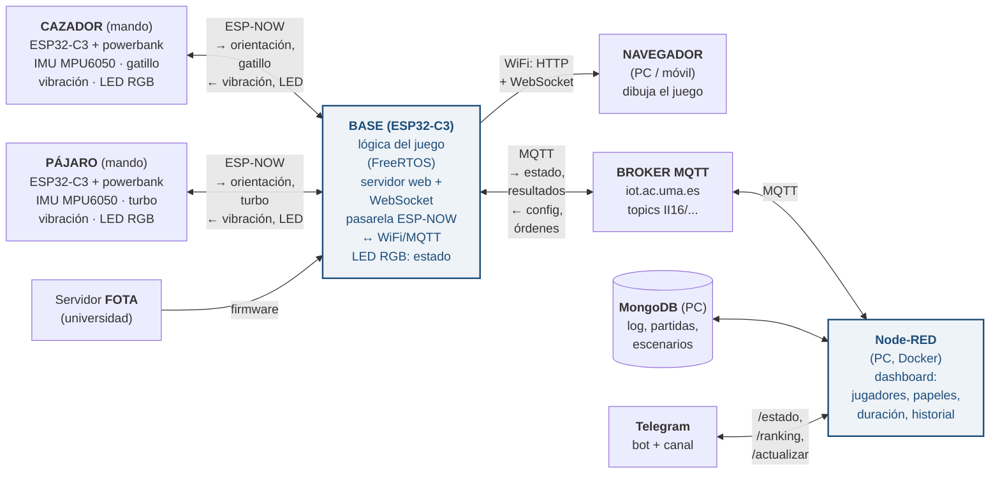

# Diagrama de bloques: Cazador vs. Pájaro

Es el mismo diagrama que lleva la propuesta en PDF (`Propuesta_G16_Cazador_vs_Pajaro.pdf`).
Si lo cambiáis aquí, copiad el bloque a `diagrama.mmd` y regenerad la imagen y el PDF:
```powershell
npx -p @mermaid-js/mermaid-cli mmdc -i diagrama.mmd -o diagrama.png -s 3 -b white -c mermaid-config.json
python generar_propuesta.py
```



- Todo va en la misma WiFi (hotspot del móvil o router, 2,4 GHz). Más detalle en [../../ARQUITECTURA.md](../../ARQUITECTURA.md).
